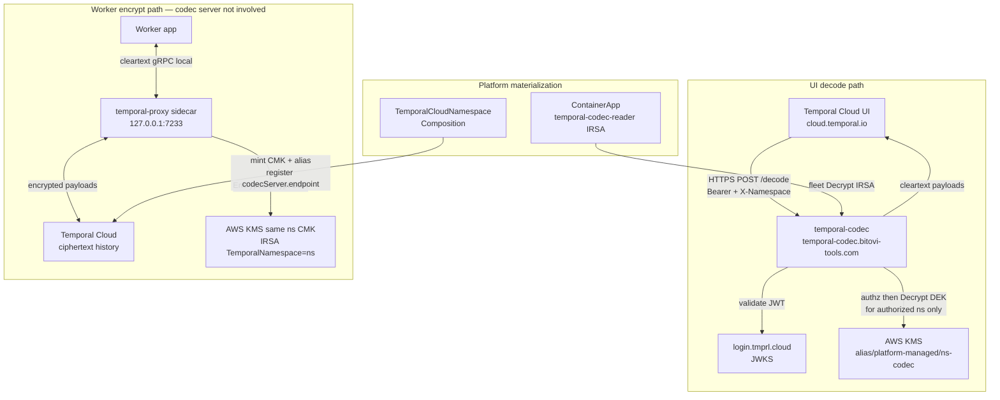
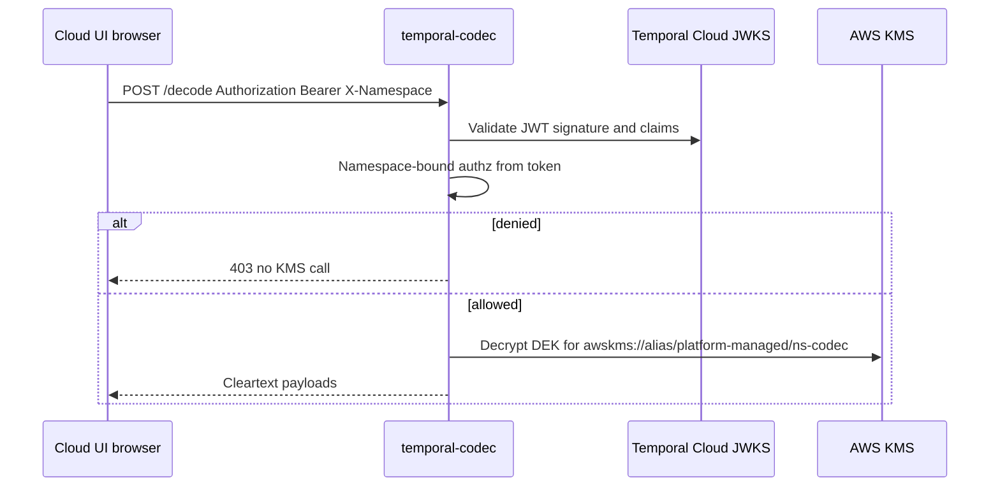

# temporal-codec

Shared **Codec Server** for Bitovi platform + Temporal Cloud UI. GitHub:
[bitovi/temporal-codec](https://github.com/bitovi/temporal-codec).

This process is the HTTPS decode endpoint Temporal Cloud UI (and CLI) call to
unwrap encrypted workflow payloads. It is a **platform prerequisite** (Argo wave
30), not something product teams deploy. Workers encrypt on a different path
(temporal-proxy sidecar + the same per-namespace KMS CMK) and **never** call
this service for encrypt.

Design intent and composition ownership live in platform ADR 0008:

`bitovi-platform-services/docs/architecture/adr/0008-temporal-cloud-codec-server.md`

| Concern | Owner |
| --- | --- |
| This binary, Dockerfile, `deploy/values.yaml` | **this repo** |
| Argo Application, charts, TCN / ContainerApp compositions | **bitovi-platform-services** |
| Worker image + business workflows | product app repos |

---

## Product role

| Path | Who | What |
| --- | --- | --- |
| **UI / CLI decode** | This service (`POST /decode`) | Temporal Cloud UI browser → HTTPS → JWT authn/authz → AWS KMS unwrap for **one** namespace CMK |
| **Worker encrypt** | temporal-proxy sidecar in the worker pod | App ↔ localhost:7233 ↔ Temporal Cloud (ciphertext on the wire). Uses IRSA + the **same** namespace CMK. **Not this process** |

### Production HTTP surface

| Route | Auth | Role |
| --- | --- | --- |
| `POST /decode` | Bearer JWT + namespace-bound authz | Primary UI path |
| `GET /health` | none | Liveness and readiness |
| `POST /encode` | off unless `ENABLE_ENCODE=true` | Local/debug only |

Body shape matches Temporal `converter.NewPayloadCodecHTTPHandler`:
`{"payloads":[...]}`.

### Per-namespace KMS

One CMK per Temporal Cloud namespace (minted by `TemporalCloudNamespace`
composition when codec is enabled):

```text
alias/platform-managed/<namespace>-codec
# URI: awskms://alias/platform-managed/<namespace>-codec
```

Tags (platform): `Purpose=temporal-codec`, `TemporalNamespace=<namespace>`.

The Codec Server is configured with a template, for example:

```text
ENCRYPTION_URI_TEMPLATE=awskms://alias/platform-managed/%s-codec
```

After the request is authorized for a namespace short name, decrypt uses **only**
that namespace’s key. It must not unwrap namespace A payloads with namespace B’s
KEK, and must not honor an arbitrary wire `encryption-key-id` under fleet-reader
IRSA.

### Authn / authz (v1)

1. Namespace `codecServer.passAccessToken` is true so Cloud UI forwards the user
   access token.
2. Validate JWT against Temporal Cloud JWKS
   (`https://login.tmprl.cloud/.well-known/jwks.json` by default).
3. **`X-Namespace` alone never authorizes.** It is client-supplied.
4. Token claims must permit the requested namespace (claim name configurable via
   `TEMPORAL_NAMESPACE_PERMISSION_CLAIM`, default `permissions`). Deny → **403**,
   no KMS call.
5. CORS allows `https://cloud.temporal.io` for the browser only. CORS is **not**
   access control.

**Claim mapping note:** interface and unit tests exercise claim-based deny/allow.
Live Temporal Cloud JWT claim schema should be verified against a real
`passAccessToken` token before locking production authz assumptions.

### Wire format

Pin: **`github.com/temporalio/temporal-proxy v0.4.0`** (`pkg/crypto`).

Metadata matches temporal-proxy encryption encoding (`binary/encrypted`,
`encryption-key-id`, `encryption-dek`). Static AES legacy codecs are not
compatible and must not be mixed with this history.

### Token sink

Never log: `Authorization`, raw JWTs, request or response payload bodies, DEKs.

Structured access logs may include status, duration, namespace, and principal
`sub` when safe.

---

## Architecture

### End-to-end flow



### UI decode sequence



**Failure domains:** if this service is down, worker encrypt can still succeed
(proxy + IRSA). UI cleartext fails. Run multi-replica with a real `/health`
readiness probe.

### IRSA blast radius (intentional split)

| Identity | Actions | Scope |
| --- | --- | --- |
| **temporal-codec** (fleet reader) | Decrypt (unwrap) | Keys tagged `Purpose=temporal-codec` (all namespace codec keys) |
| **Worker / temporal-proxy** | Encrypt + Decrypt | `Purpose=temporal-codec` **and** `TemporalNamespace=<name>` |

Application authz limits org members; the shared reader identity remains a host-
compromise residual risk of one Codec Server (accepted trade-off until narrower
reader identities exist).

---

## Local setup

### Prerequisites

- Go **1.26.4+** (module toolchain; `GOTOOLCHAIN=auto` works if needed)
- Optional: AWS credentials + KMS access for live `awskms://` decrypt acceptance
- Docker only if you prefer running the image instead of `go run`

### Configuration

Copy the example and adjust:

```bash
cp .env.example .env
```

`.env` is gitignored. Never commit secrets.

| Variable | Default | Purpose |
| --- | --- | --- |
| `PORT` | `8080` | HTTP listen port |
| `LOG_LEVEL` | `info` | `debug` / `info` / `warn` / `error` |
| `ENCRYPTION_URI` | empty | Single default URI (`testing://…` local, or one `awskms://`). Required unless template or overrides supply URIs |
| `ENCRYPTION_URI_TEMPLATE` | empty | Production fleet form: `awskms://alias/platform-managed/%s-codec` (`%s` = authorized Cloud short name) |
| `ENCRYPTION_URI_OVERRIDES` | empty | Comma map `ns=uri,ns2=uri2` for tests or break-glass |
| `TEMPORAL_CLOUD_JWKS_URL` | Cloud JWKS URL | Public HTTPS JWKS for JWT validation |
| `TEMPORAL_CLOUD_JWT_AUDIENCE` | `https://saas-api.tmprl.cloud` | Expected JWT audience |
| `TEMPORAL_CLOUD_JWT_ISSUER` | empty | Optional issuer pin |
| `TEMPORAL_NAMESPACE_PERMISSION_CLAIM` | `permissions` | Claim name carrying namespace membership list |
| `JWKS_REFRESH_INTERVAL` | `1h` | JWKS refresh period |
| `CORS_ALLOWED_ORIGINS` | `https://cloud.temporal.io` | CSV of allowed browser origins (not authz) |
| `AUTH_DISABLED` | `false` | Local only: skips JWKS and allows any bearer. **Never true in cluster** |
| `ENABLE_ENCODE` | `false` | When true, also serves `POST /encode` for local debug |
| `READ_HEADER_TIMEOUT` | `10s` | HTTP server header timeout |

At process start, at least one of `ENCRYPTION_URI`, `ENCRYPTION_URI_TEMPLATE`,
or `ENCRYPTION_URI_OVERRIDES` must be set.

### Run

```bash
# Load env (zsh/bash; skip comments)
set -a && source .env && set +a

go run ./cmd/server
```

Health:

```bash
curl -sS http://localhost:8080/health
```

With auth disabled and `testing://` encryption, you can exercise decode against
fixtures from unit tests. With real JWTs and `awskms://`, use Cluster IRSA or
your developer role that can `kms:Decrypt` the target alias.

Build binary:

```bash
go build -o /tmp/temporal-codec ./cmd/server
```

Docker:

```bash
docker build -t temporal-codec:dev .
docker run --rm -p 8080:8080 \
  -e ENCRYPTION_URI='testing://KioqKioqKioqKioqKioqKioqKioqKioqKioqKioqKio=' \
  -e AUTH_DISABLED=true \
  temporal-codec:dev
```

---

## Tests

```bash
export GOTOOLCHAIN=auto   # if local go < 1.26.4
go test ./...
```

Wire-compat (proxy seal → this codec’s decode, `testing://`, no `Encode` path):

```bash
go test ./internal/codec/ -run ProxyEncrypt_CodecDecode_wireCompat -count=1
```

Optional live KMS gate (ADR acceptance gate 1):

```bash
WIRECOMPAT_AWSKMS_URI='awskms://alias/platform-managed/<ns>-codec' \
  go test ./internal/codec/ -run awskmsOptional -count=1
```

Auth unit tests cover authorized-namespace allow and wrong-namespace deny without
calling KMS on deny.

---

## Deploy (platform)

This repo ships the image contract and interface sketch only. Cluster wiring
lives in **bitovi-platform-services**.

1. **App packaging (this repo)**
   - `Dockerfile` multi-stage Go image
   - `deploy/values.yaml` — `kind: server`, port `8080`, host
     `temporal-codec.bitovi-tools.com`, multi-replica, env for JWKS + CORS +
     `ENCRYPTION_URI_TEMPLATE`, capability `temporal-codec-reader`
   - CI pushes the image to ECR and write-backs `image.tag` (same pattern as
     other platform container apps)

2. **GitOps (platform repo)**
   - `gitops/apps/temporal-codec.yaml` — Argo Application, **sync wave 30**,
     multi-source: this repo’s values + `charts/interface` /
     `charts/platform-app-resources`
   - Optional overlay under `gitops/temporal-codec/` only if something cannot
     live in the app values

3. **IAM**
   - Capability **`temporal-codec-reader`**: fleet `kms:Decrypt` /
     `DescribeKey` on keys tagged `Purpose=temporal-codec` (no key Create)

4. **Namespaces / workers (out of band of this repo)**
   - `TemporalCloudNamespace` composition mints
     `alias/platform-managed/<namespace>-codec` and registers:
     - `codecServer.endpoint: https://temporal-codec.bitovi-tools.com`
     - `passAccessToken: true`
   - Product workers get temporal-proxy + namespace-scoped consumer IRSA via
     the interface (`kind: worker` + `dependencies.temporal`). They do not
     deploy this service.

Public URL: **`https://temporal-codec.bitovi-tools.com`**. TLS and DNS use the
platform wildcard and shared ALB (not configured in this repo).

### Accept before production `codecServer` registration

From ADR 0008:

1. Wire-compat decode of a real temporal-proxy `awskms://` payload against KMS
2. Namespace-bound authz proven with real Cloud JWT claims
3. Fail-closed **worker** encrypt (proxy path; not this HTTP service)

---

## Repository layout

```text
cmd/server/          process entrypoint
internal/config/     env loading
internal/auth/       JWKS validation, claims authz, middleware
internal/codec/      temporal-proxy pkg/crypto + payload adapter + wire tests
internal/httpapi/    routes, CORS, token-safe access logging
deploy/values.yaml   platform ContainerApp interface sketch
Dockerfile
.env.example
```

Platform Application YAML, compositions, and goldens do **not** live here.

---

## Related

- ADR 0008 — Temporal Cloud Codec Server (platform design)
- [Temporal Codec Server docs](https://docs.temporal.io/codec-server)
- [Data encryption](https://docs.temporal.io/production-deployment/data-encryption)
- [temporal-proxy](https://docs.temporal.io/production-deployment/temporal-proxy/)
